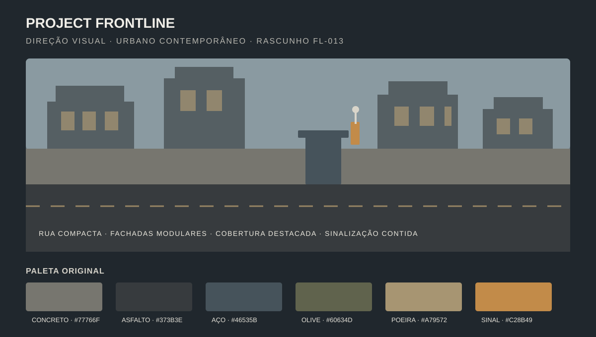

# Direção de arte — FL-013

**Estado:** direção aprovada pelo proprietário; dois assets gratuitos selecionados para inspeção em quarentena. Auditoria e benchmark no Studio pendentes.

**Data da consulta ao Creator Store:** 2026-10-15.
**Objetivo aprovado:** FPS militar urbano contemporâneo, original, legível e compatível com a escala Roblox. Sem reproduzir marcas, mapas, uniformes ou trade dress identificável de Battlefield.

## Moodboard próprio

Conceito: rua urbana compacta vista ao nível do jogador, fachadas modulares de concreto e metal pintado, asfalto gasto, cobertura de leitura clara e sinalização funcional. Luz diurna nublada, contraste controlado e saturação baixa; pontos de interação usam âmbar discreto. Silhuetas de personagens e alvos permanecem distintas do fundo.

Paleta inicial: concreto `#77766F`, asfalto `#373B3E`, aço escuro `#46535B`, olive `#60634D`, poeira `#A79572` e sinalização âmbar `#C28B49`. São amostras próprias para o protótipo, não cores extraídas de outra franquia.

## Comparação de coleções

Contagens são as mostradas nas páginas públicas do Creator Store na data acima. São metadados dos pacotes inteiros, não previsão de desempenho do subconjunto que poderia entrar no mapa.

| Coleção | Autor/listagem | Dados publicados | Licença/preço observado | Avaliação para Frontline |
|---|---|---|---|---|
| [Modular Building Kit — Modern City](https://create.roblox.com/store/asset/13168370735/Modular-Building-Kit-Modern-City) | `@Roblox` | 796.055 triângulos, 3.025 MeshParts, 36 decals, 4 áudios e 8 scripts | Get Model no Creator Store; seguir os termos vigentes e conferir dependências | Modular e útil como referência, mas o pacote inteiro excede o orçamento preliminar e os scripts exigem auditoria; não selecionar completo. |
| [Synty City Pack](https://create.roblox.com/store/asset/6933556508/Synty-City-Pack) | `@Roblox` | 256.709 triângulos e 332 MeshParts | Get Model no Creator Store; descrição informa licença da versão Roblox para uso em jogos Roblox; confirmar dependências e termos no momento da ingestão | Escala moderada, conteúdo modular e estilo low-poly consistente; destoa da direção de realismo estilizado contemporâneo. Manter como alternativa estilizada, sem aprovação. |
| [New York City Corner Apartment Building](https://create.roblox.com/store/asset/14243660153/New-York-City-Corner-Apartment-Building) | `@Lihtsameelseke` | A listagem não expõe contagem de triângulos, MeshParts ou scripts | Get Model gratuito; Creator Store ToU aplicam-se; confirmar permissões das dependências na ingestão | **Escolhido pelo proprietário para inspeção.** Fachada urbana contemporânea que parece compatível com a direção. Escala, scripts, geometria e desempenho ainda precisam ser verificados no Studio. |
| [City Props Pack](https://create.roblox.com/store/asset/6370681139) | `@Roblox` | 66.318 triângulos, 94 MeshParts e 2 scripts; inclui props urbanos e materiais PBR | Get Model gratuito; Creator Store ToU aplicam-se; confirmar permissões das dependências na ingestão | **Escolhido pelo proprietário para inspeção.** Complementa a fachada com detalhes urbanos; auditar os 2 scripts e selecionar somente os props coerentes com a paleta. |
| [Realistic Urban City](https://create.roblox.com/store/asset/95798439683690/Realistic-Urban-City) | `@2XQUISITE_DESIGNS` | 23.119 triângulos, 45 MeshParts e 11 decals; a página não informa contagem de scripts | US$ 3,99 na consulta; não cabe no orçamento disponível | Descartado pelo proprietário por ser pago. Não comprar nem usar. |

O Creator Store informa distribuidor, tipo, descrição e dados técnicos quando disponíveis; alguns modelos incluem scripts. A política da Roblox exige aderência aos Termos de Uso e recomenda auditoria antes do uso. Os dois itens escolhidos permanecem `DISCOVERED` na quarentena planejada: ainda não foram inseridos, auditados ou aprovados para a arena.

## Qualidade e orçamento preliminares

Direção proposta: **realismo estilizado contido**. Manter formas, escala e desgaste reconhecíveis, simplificar pequenos detalhes para leitura em movimento e repetir módulos com variações de cor autorizadas.

| Classe | Triângulos estimados por asset | Geometria | Texturas propostas |
|---|---:|---:|---|
| Prop pequeno (cone, caixa, placa) | até 3.000 | até 2 MeshParts | atlas compartilhado até 512² |
| Módulo urbano reutilizável | até 10.000 | até 4 MeshParts | até 2 mapas 1024² compartilhados pelo kit |
| Elemento de destaque | até 25.000 | até 8 MeshParts | até 2 mapas 1024²; usar com parcimônia |
| Cena visível da arena inicial | alvo provisório até 250.000 no total | alvo provisório até 300 MeshParts | reusar atlas/material sempre que possível |

Os limites por asset continuam **hipóteses de trabalho**, não resultados medidos. No baseline de greybox informado pelo proprietário para a FL-012 foram observados 60 FPS e 1,6 GB de memória; isso não mede o impacto dos novos assets. Comparar novamente no Studio após inserir os itens em quarentena e remover qualquer peça/scripts desnecessários. A meta de 60 FPS desktop é inicial e deve ser avaliada em hardware semelhante ao do playtest.

## Guia de materiais

- Concreto: `Concrete` ou superfície PBR moderada; variação sutil, sem ruído fino que prejudique a silhueta.
- Asfalto: cinza carvão fosco, marcação viária esparsa e contraste suficiente para leitura das rotas.
- Metal pintado: azul-aço/olive dessaturado, roughness alto e desgaste localizado.
- Vidro: uso limitado; evitar transparência e reflexos em fachadas sem função de gameplay.
- Sinalização: âmbar e branco apenas para navegação/interação; preservar o contraste entre equipes quando elas forem implementadas.

## Gate de seleção e ingestão

1. Registrar o baseline greybox da FL-012: 60 FPS e 1,6 GB, conforme relato do proprietário; comparar após a auditoria no Studio.
2. Conferir na inserção o autor, Get Model, permissões e termos vigentes dos dois assets escolhidos.
3. Inserir somente em um lugar/cena de quarentena; inspecionar descendentes, scripts, dependências, meshes, texturas, colisões e escala antes de habilitar código.
4. Harmonizar os props selecionados com a paleta e os materiais da direção visual.
5. Registrar evidência no `assets/registry.csv`; só marcar `APPROVED` depois da revisão e do teste de desempenho. O pacote pago está descartado por falta de orçamento.

## Fontes

- [Roblox Creator Store — documentação e segurança de assets](https://create.roblox.com/docs/production/creator-store)
- [Roblox — montagem de ambientes modulares](https://create.roblox.com/docs/tutorials/use-case-tutorials/modeling/assemble-modular-environments)
- [New York City Corner Apartment Building — Creator Store](https://create.roblox.com/store/asset/14243660153/New-York-City-Corner-Apartment-Building)
- [City Props Pack — Creator Store](https://create.roblox.com/store/asset/6370681139)
